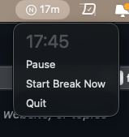
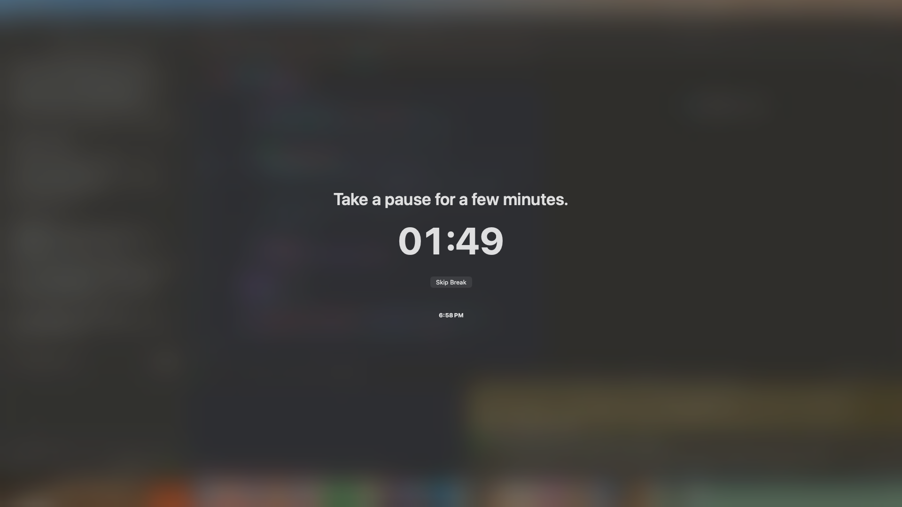

**Namidoro**

Namidoro is a simple macOS focus timer, currently a work in progress, designed to keep you focused without distractions. It sits conveniently in your menu bar as an accessory app (no Dock icon) and reminds you to take breaks with a full-screen break view after every work session.

Features
- Menu Bar Timer: Always accessible and unobtrusive while you work, showing the time left and your selected task.
- Work and Break Cycles: Focus for a work session, then take a full-screen break — 25 and 5 minutes by default, both configurable in Settings.
- Full-Screen Breaks: Gentle reminders to rest and recharge, shown on every connected display, with Escape or Skip Break to end one early.
- Task List: Jot down what you're working on and pick one to show alongside the timer.
- Settings: Adjust work/break durations, the 1-minute warning, sounds, and Launch at Login — all from an inline panel in the menu bar popover.
- Minimal & Clean Design: Simple interface with no unnecessary clutter.

Screenshots

Installation

Requires macOS 15.5+ and Xcode 16+.

1. Clone this repository.
2. Open `Namidoro.xcodeproj` in Xcode.
3. Run the `Namidoro` scheme.

Usage
1. Launch Namidoro; the timer appears in your menu bar.
2. Focus on work for the configured duration (25 minutes by default).
3. When the session ends, a full-screen break view appears on every display.
4. Repeat sessions to maintain productivity and healthy breaks.

Contributing
Contributions, suggestions, and bug reports are welcome!
